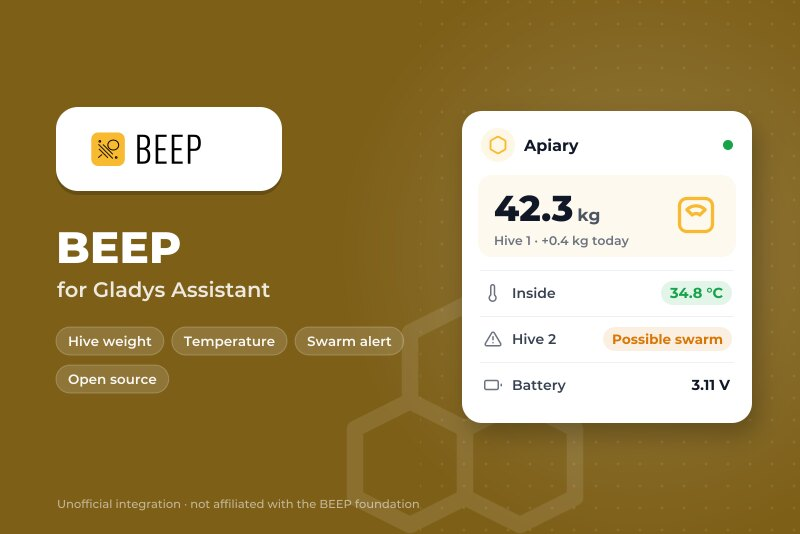
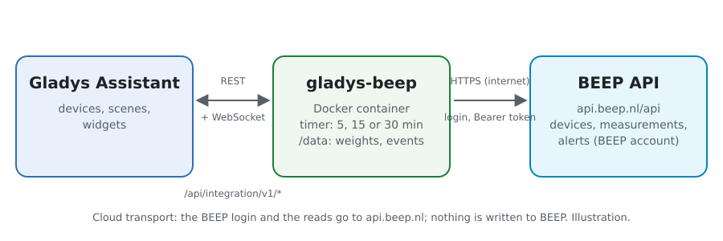
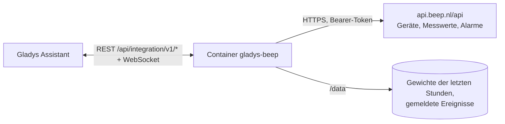
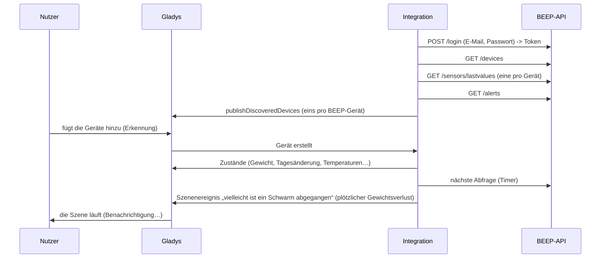
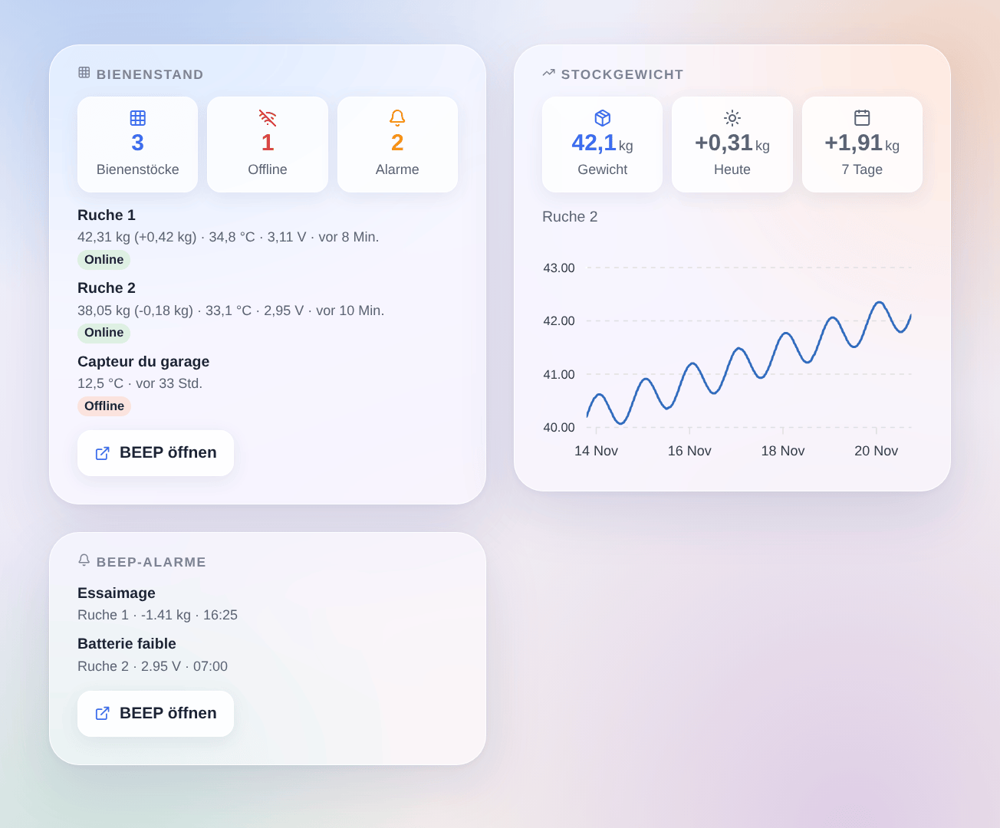

# Gladys BEEP

[English](README.md) · [Français](README.fr.md) · **Deutsch** · [Español](README.es.md)

[](LICENSE)
[](https://github.com/William-De71/gladys-beep/releases)
[](https://github.com/William-De71/gladys-beep/actions/workflows/release.yml)
[](https://gladysassistant.com)



Externe [Gladys-Assistant](https://gladysassistant.com)-Integration für **[BEEP](https://beep.nl)**, die Open-Source-Plattform der BEEP-Stiftung zur Überwachung von Bienenstöcken: Gewicht, Temperatur und Batterie deiner Stöcke, Szenen, wenn vielleicht ein Schwarm abgegangen ist oder ein Gerät nicht mehr sendet, und Dashboard-Widgets. Sie liest die API deines BEEP-Kontos (app.beep.nl).

## Funktionen

- **Ein Gerät pro BEEP-Gerät** (eine BEEP base unter einem Stock oder jeder Sensor, der Messwerte an BEEP sendet), benannt nach seinem Bienenstock: Gewicht, Gewichtsänderung des Tages, Innentemperatur, Temperaturfühler, Außentemperatur, Luftfeuchtigkeit, Luftdruck, Helligkeit, Schallpegel, Bienenzähler, Batteriespannung, je nachdem, was das Gerät misst.
- **3 Szenenauslöser**, **1 Szenenaktion** und **3 Dashboard-Widgets** (unten).
- **Schwarmerkennung**: Ein plötzlicher Gewichtsverlust (0,5 bis 3 kg innerhalb einer Stunde, einstellbar) löst eine Szene aus.
- Abfrage mit eigenem Timer (alle 5, 15 oder 30 Min.): 2 Anfragen, plus eine pro Gerät. Was die Auslöser gemeldet haben und die Gewichte der letzten Stunden werden in `/data` gespeichert.
- Nur lesend: Die Integration ändert nie etwas in BEEP.
- Überall vier Sprachen: Englisch, Französisch, Deutsch, Spanisch.

## Funktionsweise







### Übertragung

`transports: ["cloud"]`: Alles geht per HTTPS an `api.beep.nl`. Die Integration meldet sich mit der E-Mail-Adresse und dem Passwort der Konfiguration an; das von BEEP zurückgegebene Token bleibt im Speicher (nie in `/data`) und wird in einem Header übertragen, nie in der URL. Ein 401 meldet einmal neu an.

## Geräte und Funktionen

| Gerät            | Funktion                    | Kategorie / Typ                | Einheit |
| ---------------- | --------------------------- | ------------------------------ | ------- |
| \<Stock\> (BEEP) | Gewicht (kg)                | `counter-sensor` / decimal     |         |
|                  | Gewichtsänderung heute (kg) | `counter-sensor` / decimal     |         |
|                  | Innentemperatur             | `temperature-sensor` / decimal | °C      |
|                  | Innenluftfeuchtigkeit       | `humidity-sensor` / decimal    | %       |
|                  | Temperatur                  | `temperature-sensor` / decimal | °C      |
|                  | Luftfeuchtigkeit            | `humidity-sensor` / decimal    | %       |
|                  | Luftdruck                   | `pressure-sensor` / decimal    | hPa     |
|                  | Helligkeit                  | `light-sensor` / decimal       | lux     |
|                  | Schallpegel                 | `noise-sensor` / decimal       | dB      |
|                  | Ein- / ausfliegende Bienen  | `counter-sensor` / integer     |         |
|                  | Batteriespannung            | `energy-sensor` / voltage      | V       |
|                  | Temperaturfühler 1 bis 10   | `temperature-sensor` / decimal | °C      |

Ein Gerät bietet nur die Messwerte an, die es gesendet hat (BEEP-Kürzel `weight_kg`, `t_i`, `h_i`, `t`, `h`, `p`, `l`, `s_spl`, `bc_i`, `bc_o`, `bv`, `t_0`…`t_9`), und behält sie, sobald sie angeboten wurden. Gladys hat noch keine Einheit Kilogramm: Die Gewichte sind dezimale `counter-sensor`, deren Name „kg“ angibt.

## Szenenauslöser, Aktionen und Widgets



- **Auslöser „BEEP: Vielleicht ist ein Schwarm abgegangen“**: Das Gewicht eines Stocks ist um den eingestellten Wert unter sein höchstes Gewicht der letzten Stunde gefallen; einmal pro Stock alle 6 Stunden. Variablen: `device`, `hive`, `device_name`, `weight_before`, `weight_after`, `drop_kg`, `measured_at`, `summary`.
- **Auslöser „BEEP: Ein Gerät sendet nicht mehr“**: BEEP markiert ein Gerät als offline (kein Messwert während des Doppelten seines Sendeintervalls). Variablen: `device`, `hive`, `device_name`, `last_message_at`, `summary`.
- **Auslöser „BEEP: Alarm“**: Eine Alarmregel des BEEP-Kontos hat ausgelöst (ein neuer Alarm oder derselbe erneut); höchstens 10 pro Abfrage. Variablen: `rule`, `value`, `device`, `hive`, `device_name`, `location`, `count`, `alert_id`, `summary`.
- **Aktion „BEEP: Zusammenfassung des Bienenstands“**: Ausgaben `summary` (eine Zeile pro Stock), `hives`, `offline`, `alerts`, `total_weight_kg`.
- **Widgets**: „Bienenstand“ (Kacheln, jeder Stock mit Gewicht, Tagesänderung, Temperatur, Batterie, Alter des letzten Messwerts, online oder nicht), „Stockgewicht“ (7 Tage aus BEEP gelesen, eine Kurve pro Stock oder der Stock aus den Einstellungen), „BEEP-Alarme“ (die neuesten zuerst).

Die Auslöser lassen sich auf einen Bienenstock filtern (`device`). Die erste Abfrage dient als Referenz: Bereits offline gemeldete Geräte und bereits gelistete Alarme lösen nichts aus. Beispiele:

- _Vielleicht ist ein Schwarm abgegangen_ → `{{triggerEvent.data.summary}}` per Telegram senden und das Gartenlicht einschalten.
- _Ein Gerät sendet nicht mehr_ → eine Benachrichtigung „prüfe die Batterie von {{triggerEvent.data.hive}}“.
- _Jeden Abend um 20:00_ → **Zusammenfassung des Bienenstands** → `summary` auf dem Lautsprecher der Küche ansagen.

## Voraussetzungen

- Gladys Assistant **5.3.0** oder neuer; ältere Instanzen können die Integration nicht installieren.
- Ein BEEP-Konto ([app.beep.nl](https://app.beep.nl)) mit mindestens einem Gerät und bestätigter E-Mail-Adresse.

## Installation

- **Aus dem Store**: Integrationen → BEEP → Installieren.
- **Über die URL des Repositorys**: Integrationen → externe Integration → `https://github.com/William-De71/gladys-beep`.
- **Entwicklermodus**: Starte `npm start` mit den von Gladys bereitgestellten Variablen (siehe Entwicklung).

## Konfiguration

| Feld                                     | Standard    | Bedeutung                                                                                 |
| ---------------------------------------- | ----------- | ----------------------------------------------------------------------------------------- |
| E-Mail-Adresse                           | —           | Pflichtfeld: die E-Mail-Adresse des BEEP-Kontos                                           |
| Passwort                                 | —           | Pflichtfeld, geheim: nur an api.beep.nl gesendet, nie wieder angezeigt oder protokolliert |
| Abfrage alle                             | 15 Min.     | 5, 15 oder 30 Minuten                                                                     |
| Schwarm: Gewichtsverlust in einer Stunde | 1 kg        | 0,5, 1, 1,5, 2 oder 3 kg                                                                  |
| Sprache                                  | Automatisch | Gerätenamen und Szenentexte; automatisch: die Sprache des letzten Widgets                 |
| BEEP jetzt abfragen                      | —           | Meldet sich an, fragt jetzt ab und listet jeden Stock                                     |

## Verwendung

1. Integrationen → BEEP → Konfiguration: Gib die E-Mail-Adresse und das Passwort des BEEP-Kontos ein und drücke **BEEP jetzt abfragen**.
2. Erkennung: Füge deine Bienenstöcke hinzu.
3. Füge die Widgets einem Dashboard hinzu; erstelle Szenen mit den Auslösern und der Aktion.

## Entwicklung

```bash
npm install
npm test                       # node --test, eine falsche BEEP-API, nie das Netzwerk
npm run lint                   # ESLint
npm run format:check           # Prettier
npx github:GladysAssistant/integration-store . --skip-image-check
scripts/build-cover.sh         # cover.jpg aus docs/assets/cover.svg
docs/illustrations/render.sh   # docs/assets/widgets.<Sprache>.png
```

Lokal liest das SDK `GLADYS_HOST_API_URL`, `GLADYS_INTEGRATION_TOKEN` und `GLADYS_INTEGRATION_SELECTOR` (im Entwicklermodus von Gladys bereitgestellt), und die Integration liest `TZ`. `DEBUG=gladys-integration-sdk` zeigt die Protokolle des SDK.

Die Tests decken den HTTP-Client ab (Anmeldung, Token im Header, neue Anmeldung nach einem 401, Fehler, Wiederholung), das Lesen der BEEP-Antworten, die Ereignisse (Schwarm, offline, Alarme, Referenz, nur einmal, Neustart), die Geräte (Prüfungen von Gladys), die Widgets (`validateWidgetContent`), das Manifest, die vier Sprachen, das Release-Skript und die ganze Integration gegen das falsche Gladys des SDK. `test/structure.test.js` friert die externen IDs und alle von Nutzern gespeicherten Schlüssel ein.

## Release-Prozess


Jeder Merge auf `main` startet die CI und berechnet dann die Version aus den [Conventional Commits](https://www.conventionalcommits.org/de/) seit dem letzten Tag: `feat` → Minor, `fix` / `perf` → Patch, `!` oder `BREAKING CHANGE` → Major (unter 1.0.0 ein Minor); `docs`, `chore`, `ci`, `test`, `style`, `refactor`, `build` allein veröffentlichen nichts. Der Abschnitt des Changelogs wird erzeugt, der Tag gepusht, das Multi-Architektur-Image gebaut, dann erhält `main` den Release-Commit, das GitHub Release wird erstellt und ein letzter Job prüft das öffentliche Image, den Store-Validator und das Topic.

- Der Titel des Pull Requests wird zum Squash-Commit und dann zur Zeile im Changelog: Schreibe ihn auf Englisch, für die Nutzer (`pr-title.yml` prüft ihn). Bearbeite `CHANGELOG.md` nie von Hand.
- 1.0.0 ist eine Entscheidung: Actions → Release → Run workflow mit `release-as: 1.0.0`. `dry-run` zeigt Version und Notizen, ohne zu veröffentlichen.
- **Geschützter Branch**: Rulesets verlangen einen Pull Request auf `main` und sperren die `v*`-Tags; nur der Maintainer und Deploy Keys kommen durch. Das Release pusht mit dem Deploy Key der Umgebung `release` (Secret `RELEASE_DEPLOY_KEY`, nur `main`): Ein Lauf von einem anderen Branch erhält ihn nie. `build.yml` und `github-release.yml` starten nicht bei einem Tag: Das Release ruft sie auf, oder starten Sie sie von Hand (Actions → Run workflow, mit `version` für das Image), um ein Release abzuschließen.

## Fehlerbehebung

Siehe [docs/de.md](docs/de.md#fehlerbehebung). Melde Probleme mit den Versionen von Gladys und der Integration, deiner BEEP-Hardware und der Meldung von **BEEP jetzt abfragen**. Füge nie dein Passwort ein.

## Mitwirken

Issues und Pull Requests sind willkommen. Führe `npm run format:check && npm run lint && npm test` aus, bevor du einen Pull Request öffnest, und ändere keine externe ID und keinen gespeicherten Schlüssel (siehe [CLAUDE.md](CLAUDE.md)).

## Sicherheit

Siehe [SECURITY.md](SECURITY.md): Melde Schwachstellen vertraulich. Das Passwort ist ein `secret`-Feld: nie protokolliert, nie in `/data` geschrieben, nur an `api.beep.nl` gesendet; das Token bleibt im Speicher.

## Screenshots folgen

Die Bilder oben sind Illustrationen, keine Screenshots. Echte Screenshots kommen nach `docs/assets/screenshots/` (PNG, 1280 × 800): `configuration.png` (die Konfiguration mit ihrem Status), `discovery.png` (die angebotenen Bienenstöcke), `device.png` (ein Stock-Gerät mit seinem Gewicht), `scene-swarm.png` (eine Szene mit dem Schwarm-Auslöser).

## Lizenz

[Apache-Lizenz 2.0](LICENSE) — siehe auch [NOTICE](NOTICE). Bienenstöcke, Messwerte und Alarme: dein BEEP-Konto, über die [BEEP-API](https://github.com/beepnl/BEEP). Dieses Projekt ist nicht mit der BEEP-Stiftung verbunden und wird von ihr weder unterstützt noch gesponsert. Danke an die Dokumentation und das SDK von Gladys und an die BEEP-Stiftung für eine Open-Source-Plattform.
