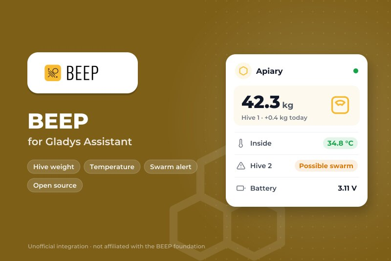
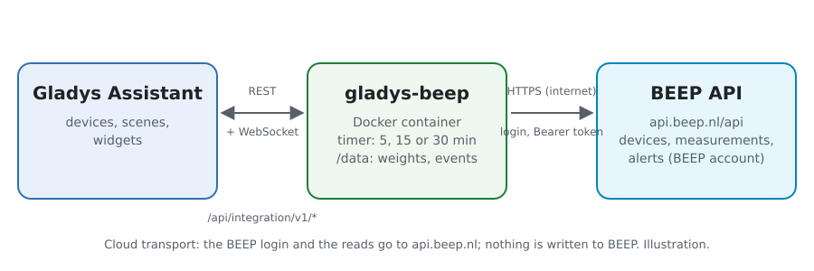
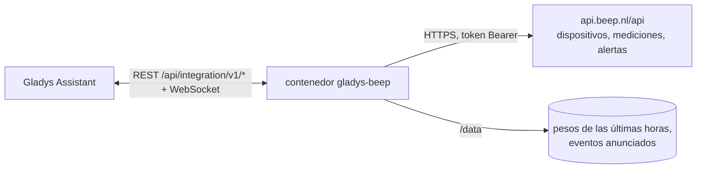
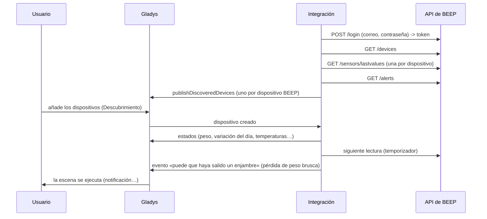
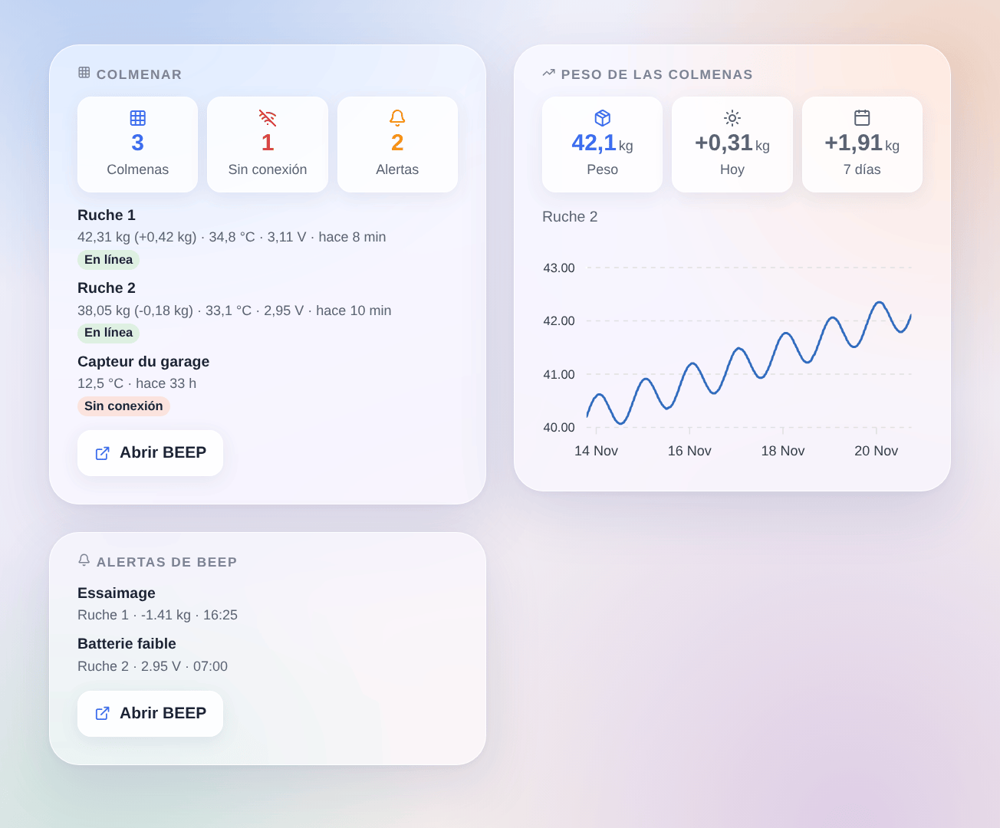

# Gladys BEEP

[English](README.md) · [Français](README.fr.md) · [Deutsch](README.de.md) · **Español**

[](LICENSE)
[](https://github.com/William-De71/gladys-beep/releases)
[](https://github.com/William-De71/gladys-beep/actions/workflows/release.yml)
[](https://gladysassistant.com)



Integración externa de [Gladys Assistant](https://gladysassistant.com) para **[BEEP](https://beep.nl)**, la plataforma de código abierto de la fundación BEEP para el seguimiento de colmenas: el peso, la temperatura y la batería de sus colmenas, escenas cuando puede que haya salido un enjambre o un dispositivo deja de enviar, y widgets de panel. Lee la API de su cuenta BEEP (app.beep.nl).

## Funciones

- **Un dispositivo por cada dispositivo BEEP** (una BEEP base bajo una colmena, o cualquier sensor que envíe sus mediciones a BEEP), con el nombre de su colmena: peso, variación de peso del día, temperatura interior, sondas de temperatura, temperatura exterior, humedad, presión atmosférica, luminosidad, nivel sonoro, contadores de abejas, tensión de la batería, según lo que mida el dispositivo.
- **3 disparadores de escena**, **1 acción de escena** y **3 widgets** de panel (abajo).
- **Detección de enjambrazón**: una pérdida de peso brusca (de 0,5 a 3 kg en una hora, configurable) dispara una escena.
- Lectura con su propio temporizador (cada 5, 15 o 30 min): 2 solicitudes, más una por dispositivo. Lo que anunciaron los disparadores y los pesos de las últimas horas se guardan en `/data`.
- Solo lectura: la integración nunca modifica nada en BEEP.
- Cuatro idiomas en todas partes: inglés, francés, alemán, español.

## Funcionamiento







### Transporte

`transports: ["cloud"]`: todo pasa por `api.beep.nl` en HTTPS. La integración inicia sesión con el correo electrónico y la contraseña de la configuración; el token que devuelve BEEP se queda en memoria (nunca en `/data`) y viaja en una cabecera, nunca en la URL. Un 401 vuelve a iniciar sesión una vez.

## Dispositivos y funciones

| Dispositivo        | Función                       | Categoría / tipo               | Unidad |
| ------------------ | ----------------------------- | ------------------------------ | ------ |
| \<colmena\> (BEEP) | Peso (kg)                     | `counter-sensor` / decimal     |        |
|                    | Variación de peso de hoy (kg) | `counter-sensor` / decimal     |        |
|                    | Temperatura interior          | `temperature-sensor` / decimal | °C     |
|                    | Humedad interior              | `humidity-sensor` / decimal    | %      |
|                    | Temperatura                   | `temperature-sensor` / decimal | °C     |
|                    | Humedad                       | `humidity-sensor` / decimal    | %      |
|                    | Presión atmosférica           | `pressure-sensor` / decimal    | hPa    |
|                    | Luminosidad                   | `light-sensor` / decimal       | lux    |
|                    | Nivel sonoro                  | `noise-sensor` / decimal       | dB     |
|                    | Abejas que entran / salen     | `counter-sensor` / integer     |        |
|                    | Tensión de la batería         | `energy-sensor` / voltage      | V      |
|                    | Sonda de temperatura 1 a 10   | `temperature-sensor` / decimal | °C     |

Un dispositivo solo ofrece las mediciones que ha enviado (abreviaturas de BEEP `weight_kg`, `t_i`, `h_i`, `t`, `h`, `p`, `l`, `s_spl`, `bc_i`, `bc_o`, `bv`, `t_0`…`t_9`), y las conserva una vez ofrecidas. Gladys todavía no tiene unidad de kilogramo: los pesos son `counter-sensor` decimales cuyo nombre indica «kg».

## Disparadores, acciones y widgets



- **Disparador «BEEP: puede que haya salido un enjambre»**: el peso de una colmena cayó la bajada configurada por debajo de su peso más alto de la última hora; una vez por colmena cada 6 horas. Variables: `device`, `hive`, `device_name`, `weight_before`, `weight_after`, `drop_kg`, `measured_at`, `summary`.
- **Disparador «BEEP: un dispositivo dejó de enviar»**: BEEP marca un dispositivo sin conexión (ninguna medición durante el doble de su intervalo de envío). Variables: `device`, `hive`, `device_name`, `last_message_at`, `summary`.
- **Disparador «BEEP: alerta»**: se activó una regla de alerta de la cuenta BEEP (una alerta nueva, o la misma de nuevo); 10 como máximo por lectura. Variables: `rule`, `value`, `device`, `hive`, `device_name`, `location`, `count`, `alert_id`, `summary`.
- **Acción «BEEP: resumen del colmenar»**: salidas `summary` (una línea por colmena), `hives`, `offline`, `alerts`, `total_weight_kg`.
- **Widgets**: «Colmenar» (mosaicos, cada colmena con peso, variación del día, temperatura, batería, antigüedad de la última medición, en línea o no), «Peso de las colmenas» (7 días leídos en BEEP, una curva por colmena o la colmena de los ajustes), «Alertas de BEEP» (las más recientes primero).

Los disparadores se filtran por colmena (`device`). La primera lectura sirve de referencia: los dispositivos ya sin conexión y las alertas ya listadas no disparan nada. Ejemplos:

- _Puede que haya salido un enjambre_ → enviar `{{triggerEvent.data.summary}}` por Telegram y encender la luz del jardín.
- _Un dispositivo dejó de enviar_ → una notificación «compruebe la batería de {{triggerEvent.data.hive}}».
- _Cada noche a las 20:00_ → **resumen del colmenar** → anunciar `summary` en el altavoz de la cocina.

## Requisitos

- Gladys Assistant **5.3.0** o posterior; las instancias más antiguas no pueden instalar la integración.
- Una cuenta BEEP ([app.beep.nl](https://app.beep.nl)) con al menos un dispositivo y el correo electrónico verificado.

## Instalación

- **Desde la tienda**: Integraciones → BEEP → Instalar.
- **Desde la URL del repositorio**: Integraciones → integración externa → `https://github.com/William-De71/gladys-beep`.
- **Modo desarrollador**: ejecute `npm start` con las variables que proporciona Gladys (ver Desarrollo).

## Configuración

| Campo                                    | Por defecto | Significado                                                                                  |
| ---------------------------------------- | ----------- | -------------------------------------------------------------------------------------------- |
| Correo electrónico                       | —           | Obligatorio: el correo electrónico de la cuenta BEEP                                         |
| Contraseña                               | —           | Obligatoria, secreta: solo se envía a api.beep.nl, nunca se vuelve a mostrar ni se registra  |
| Lectura cada                             | 15 min      | 5, 15 o 30 minutos                                                                           |
| Enjambrazón: pérdida de peso en una hora | 1 kg        | 0,5, 1, 1,5, 2 o 3 kg                                                                        |
| Idioma                                   | Automático  | Nombres de los dispositivos y textos de las escenas; automático: el idioma del último widget |
| Leer BEEP ahora                          | —           | Inicia sesión, lee ahora y enumera cada colmena                                              |

## Uso

1. Integraciones → BEEP → Configuración: introduzca el correo electrónico y la contraseña de la cuenta BEEP y pulse **Leer BEEP ahora**.
2. Descubrimiento: añada sus colmenas.
3. Añada los widgets a un panel; cree escenas con los disparadores y la acción.

## Desarrollo

```bash
npm install
npm test                       # node --test, una API de BEEP falsa, nunca la red
npm run lint                   # ESLint
npm run format:check           # Prettier
npx github:GladysAssistant/integration-store . --skip-image-check
scripts/build-cover.sh         # cover.jpg desde docs/assets/cover.svg
docs/illustrations/render.sh   # docs/assets/widgets.<idioma>.png
```

En local, el SDK lee `GLADYS_HOST_API_URL`, `GLADYS_INTEGRATION_TOKEN` y `GLADYS_INTEGRATION_SELECTOR` (proporcionados por Gladys en modo desarrollador), y la integración lee `TZ`. `DEBUG=gladys-integration-sdk` muestra los registros del SDK.

Las pruebas cubren el cliente HTTP (inicio de sesión, token en cabecera, nuevo inicio de sesión tras un 401, errores, reintento), la lectura de las respuestas de BEEP, los eventos (enjambrazón, sin conexión, alertas, referencia, una sola vez, reinicio), los dispositivos (comprobaciones de Gladys), los widgets (`validateWidgetContent`), el manifiesto, los cuatro idiomas, el script de publicación y la integración completa frente al Gladys falso del SDK. `test/structure.test.js` congela los identificadores externos y todas las claves que guardan los usuarios.

## Proceso de publicación


Cada fusión en `main` ejecuta la CI y calcula la versión a partir de los [Conventional Commits](https://www.conventionalcommits.org/es/) desde la última etiqueta: `feat` → menor, `fix` / `perf` → parche, `!` o `BREAKING CHANGE` → mayor (una menor por debajo de 1.0.0); `docs`, `chore`, `ci`, `test`, `style`, `refactor`, `build` solos no publican nada. Se genera la sección del changelog, se envía la etiqueta, se construye la imagen multiarquitectura, luego `main` recibe el commit de publicación, se crea la GitHub Release y un último job comprueba la imagen pública, el validador de la tienda y el topic.

- El título de la pull request se convierte en el commit squash y luego en la línea del changelog: escríbalo en inglés, para el usuario (`pr-title.yml` lo comprueba). Nunca edite `CHANGELOG.md` a mano.
- La 1.0.0 es una decisión: Actions → Release → Run workflow con `release-as: 1.0.0`. `dry-run` muestra la versión y las notas sin publicar.
- **Rama protegida**: la publicación envía su commit a `main` con `GITHUB_TOKEN`. El ruleset `protect-main` (sin borrado ni force-push) lo deja pasar; una regla más estricta (pull request obligatoria, status checks) necesitaría GitHub Actions en la lista de exclusión, o una GitHub App.

## Solución de problemas

Vea [docs/es.md](docs/es.md#solución-de-problemas). Informe de los problemas con las versiones de Gladys y de la integración, su hardware BEEP y el mensaje de **Leer BEEP ahora**. Nunca pegue su contraseña.

## Contribuir

Las issues y pull requests son bienvenidas. Ejecute `npm run format:check && npm run lint && npm test` antes de abrir una pull request, y no cambie ningún identificador externo ni ninguna clave guardada (vea [CLAUDE.md](CLAUDE.md)).

## Seguridad

Vea [SECURITY.md](SECURITY.md): informe de las vulnerabilidades en privado. La contraseña es un campo `secret`: nunca se registra, nunca se escribe en `/data`, solo se envía a `api.beep.nl`; el token se queda en memoria.

## Capturas pendientes

Las imágenes de arriba son ilustraciones, no capturas de pantalla. Las capturas reales irán en `docs/assets/screenshots/` (PNG, 1280 × 800): `configuration.png` (la configuración con su estado), `discovery.png` (las colmenas ofrecidas), `device.png` (un dispositivo colmena con su peso), `scene-swarm.png` (una escena con el disparador de enjambrazón).

## Licencia

[Licencia Apache 2.0](LICENSE) — vea también [NOTICE](NOTICE). Colmenas, mediciones y alertas: su cuenta BEEP, a través de la [API de BEEP](https://github.com/beepnl/BEEP). Este proyecto no está afiliado a la fundación BEEP, ni respaldado ni patrocinado por ella. Gracias a la documentación y al SDK de Gladys, y a la fundación BEEP por una plataforma de código abierto.
