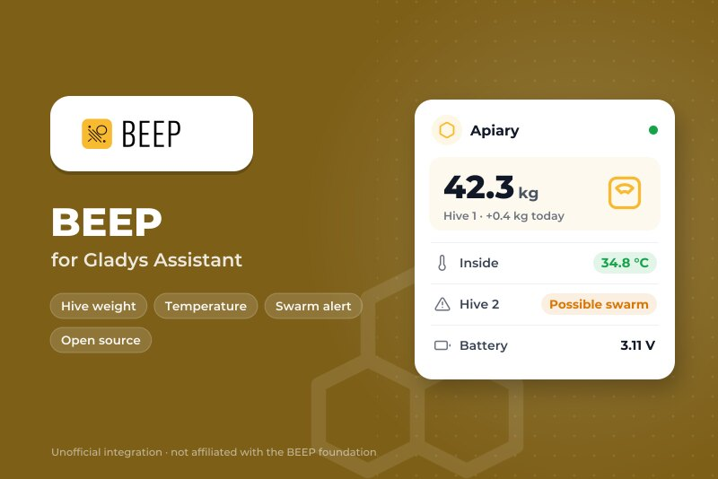
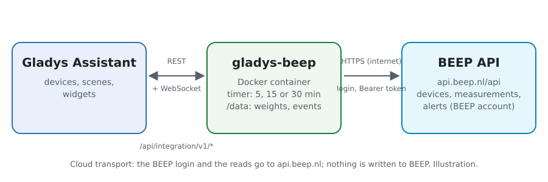
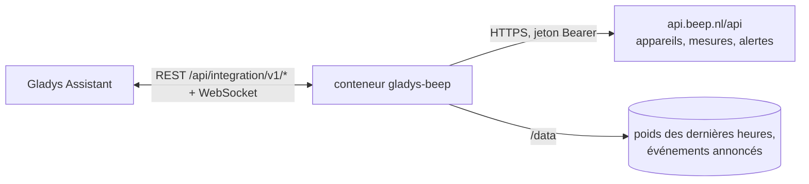
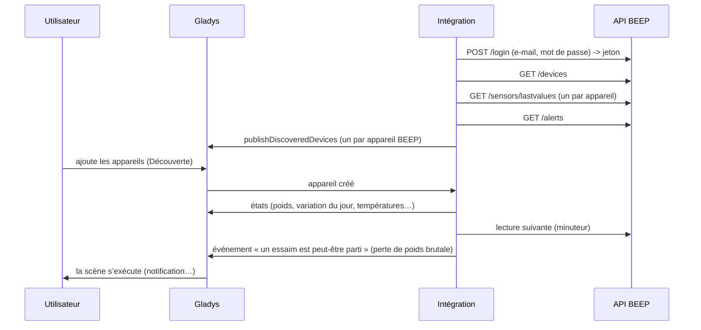
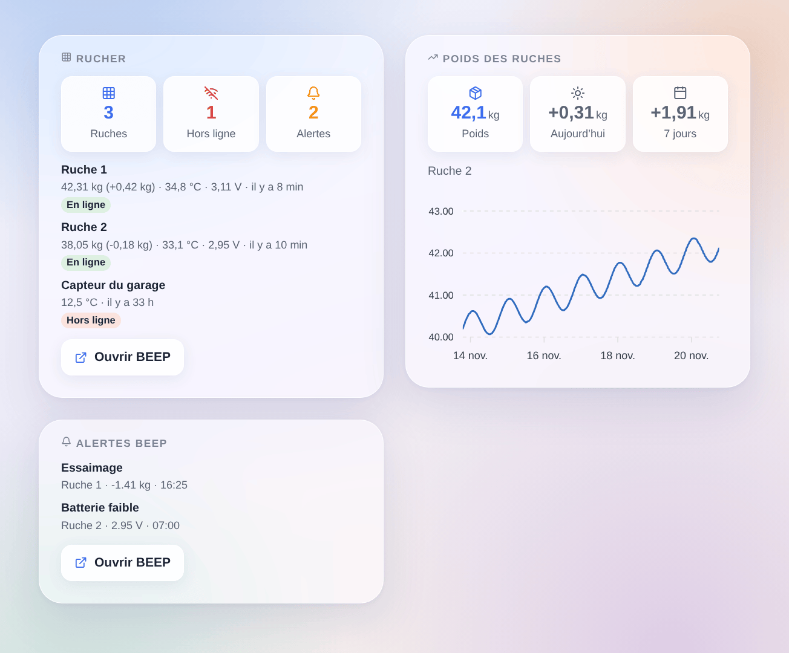

# Gladys BEEP

[English](README.md) · **Français** · [Deutsch](README.de.md) · [Español](README.es.md)

[](LICENSE)
[](https://github.com/William-De71/gladys-beep/releases)
[](https://github.com/William-De71/gladys-beep/actions/workflows/release.yml)
[](https://gladysassistant.com)



Intégration externe [Gladys Assistant](https://gladysassistant.com) pour **[BEEP](https://beep.nl)**, la plateforme open source de suivi des ruches de la fondation BEEP : le poids, la température et la batterie de vos ruches, des scènes quand un essaim est peut-être parti ou qu’un appareil n’envoie plus rien, et des widgets de tableau de bord. Elle lit l’API de votre compte BEEP (app.beep.nl).

## Fonctionnalités

- **Un appareil par appareil BEEP** (une BEEP base sous une ruche, ou tout capteur qui envoie ses mesures à BEEP), au nom de sa ruche : poids, variation de poids du jour, température intérieure, sondes de température, température extérieure, humidité, pression atmosphérique, luminosité, niveau sonore, compteurs d’abeilles, tension de la batterie, selon ce que l’appareil mesure.
- **3 déclencheurs de scène**, **1 action de scène** et **3 widgets** de tableau de bord (ci-dessous).
- **Détection d’essaimage** : une perte de poids brutale (0,5 à 3 kg en une heure, réglable) déclenche une scène.
- Lecture sur son propre minuteur (toutes les 5, 15 ou 30 min) : 2 requêtes, plus une par appareil. Ce que les déclencheurs ont annoncé et les poids des dernières heures sont gardés dans `/data`.
- Lecture seule : l’intégration ne modifie jamais rien dans BEEP.
- Quatre langues partout : anglais, français, allemand, espagnol.

## Fonctionnement







### Transport

`transports: ["cloud"]` : tout passe par `api.beep.nl` en HTTPS. L’intégration se connecte avec l’e-mail et le mot de passe de la configuration ; le jeton renvoyé par BEEP reste en mémoire (jamais dans `/data`) et voyage dans un en-tête, jamais dans l’URL. Un 401 relance une connexion une fois.

## Appareils et fonctionnalités

| Appareil         | Fonctionnalité                  | Catégorie / type               | Unité |
| ---------------- | ------------------------------- | ------------------------------ | ----- |
| \<ruche\> (BEEP) | Poids (kg)                      | `counter-sensor` / decimal     |       |
|                  | Variation de poids du jour (kg) | `counter-sensor` / decimal     |       |
|                  | Température intérieure          | `temperature-sensor` / decimal | °C    |
|                  | Humidité intérieure             | `humidity-sensor` / decimal    | %     |
|                  | Température                     | `temperature-sensor` / decimal | °C    |
|                  | Humidité                        | `humidity-sensor` / decimal    | %     |
|                  | Pression atmosphérique          | `pressure-sensor` / decimal    | hPa   |
|                  | Luminosité                      | `light-sensor` / decimal       | lux   |
|                  | Niveau sonore                   | `noise-sensor` / decimal       | dB    |
|                  | Abeilles entrées / sorties      | `counter-sensor` / integer     |       |
|                  | Tension de la batterie          | `energy-sensor` / voltage      | V     |
|                  | Sonde de température 1 à 10     | `temperature-sensor` / decimal | °C    |

Un appareil ne propose que les mesures qu’il a envoyées (abréviations BEEP `weight_kg`, `t_i`, `h_i`, `t`, `h`, `p`, `l`, `s_spl`, `bc_i`, `bc_o`, `bv`, `t_0`…`t_9`), et les garde une fois proposées. Gladys n’a pas encore d’unité kilogramme : les poids sont des `counter-sensor` décimaux dont le nom indique « kg ».

## Déclencheurs, actions et widgets



- **Déclencheur « BEEP : un essaim est peut-être parti »** : le poids d’une ruche est tombé de la baisse configurée sous son poids le plus haut de la dernière heure ; une fois par ruche toutes les 6 heures. Variables : `device`, `hive`, `device_name`, `weight_before`, `weight_after`, `drop_kg`, `measured_at`, `summary`.
- **Déclencheur « BEEP : un appareil n’envoie plus rien »** : BEEP marque un appareil hors ligne (aucune mesure pendant deux fois son intervalle d’envoi). Variables : `device`, `hive`, `device_name`, `last_message_at`, `summary`.
- **Déclencheur « BEEP : alerte »** : une règle d’alerte du compte BEEP s’est déclenchée (nouvelle alerte, ou la même levée de nouveau) ; 10 au plus par lecture. Variables : `rule`, `value`, `device`, `hive`, `device_name`, `location`, `count`, `alert_id`, `summary`.
- **Action « BEEP : résumé du rucher »** : sorties `summary` (une ligne par ruche), `hives`, `offline`, `alerts`, `total_weight_kg`.
- **Widgets** : « Rucher » (tuiles, chaque ruche avec poids, variation du jour, température, batterie, âge de la dernière mesure, en ligne ou non), « Poids des ruches » (7 jours lus dans BEEP, une courbe par ruche ou la ruche des réglages), « Alertes BEEP » (les plus récentes d’abord).

Les déclencheurs se filtrent sur une ruche (`device`). La première lecture sert de référence : les appareils déjà hors ligne et les alertes déjà listées ne déclenchent rien. Exemples :

- _Un essaim est peut-être parti_ → envoyer `{{triggerEvent.data.summary}}` par Telegram et allumer la lumière du jardin.
- _Un appareil n’envoie plus rien_ → une notification « vérifier la batterie de {{triggerEvent.data.hive}} ».
- _Chaque soir à 20 h_ → **résumé du rucher** → annoncer `summary` sur l’enceinte de la cuisine.

## Prérequis

- Gladys Assistant **5.3.0** ou plus récent ; les instances plus anciennes ne peuvent pas installer l’intégration.
- Un compte BEEP ([app.beep.nl](https://app.beep.nl)) avec au moins un appareil et un e-mail vérifié.

## Installation

- **Depuis le store** : Intégrations → BEEP → Installer.
- **Depuis l’URL du dépôt** : Intégrations → intégration externe → `https://github.com/William-De71/gladys-beep`.
- **Mode développeur** : lancez `npm start` avec les variables fournies par Gladys (voir Développement).

## Configuration

| Champ                                   | Défaut      | Signification                                                                        |
| --------------------------------------- | ----------- | ------------------------------------------------------------------------------------ |
| E-mail                                  | —           | Obligatoire : l’e-mail du compte BEEP                                                |
| Mot de passe                            | —           | Obligatoire, secret : envoyé seulement à api.beep.nl, jamais réaffiché ni journalisé |
| Lecture toutes les                      | 15 min      | 5, 15 ou 30 minutes                                                                  |
| Essaimage : perte de poids en une heure | 1 kg        | 0,5, 1, 1,5, 2 ou 3 kg                                                               |
| Langue                                  | Automatique | Noms des appareils et textes des scènes ; automatique : langue du dernier widget     |
| Lire BEEP maintenant                    | —           | Se connecte, lit maintenant et liste chaque ruche                                    |

## Utilisation

1. Intégrations → BEEP → Configuration : saisissez l’e-mail et le mot de passe du compte BEEP, appuyez sur **Lire BEEP maintenant**.
2. Découverte : ajoutez vos ruches.
3. Ajoutez les widgets à un tableau de bord ; créez des scènes avec les déclencheurs et l’action.

## Développement

```bash
npm install
npm test                       # node --test, une fausse API BEEP, jamais le réseau
npm run lint                   # ESLint
npm run format:check           # Prettier
npx github:GladysAssistant/integration-store . --skip-image-check
scripts/build-cover.sh         # cover.jpg depuis docs/assets/cover.svg
docs/illustrations/render.sh   # docs/assets/widgets.<langue>.png
```

En local, le SDK lit `GLADYS_HOST_API_URL`, `GLADYS_INTEGRATION_TOKEN` et `GLADYS_INTEGRATION_SELECTOR` (fournis par Gladys en mode développeur), et l’intégration lit `TZ`. `DEBUG=gladys-integration-sdk` affiche les journaux du SDK.

Les tests couvrent le client HTTP (connexion, jeton en en-tête, nouvelle connexion après un 401, erreurs, nouvel essai), la lecture des réponses BEEP, les événements (essaimage, hors ligne, alertes, référence, une seule fois, redémarrage), les appareils (contrôles de Gladys), les widgets (`validateWidgetContent`), le manifeste, les quatre langues, le script de release et l’intégration entière contre le faux Gladys du SDK. `test/structure.test.js` fige les identifiants externes et toutes les clés stockées par les utilisateurs.

## Processus de release


Chaque fusion sur `main` lance la CI, puis calcule la version à partir des [Conventional Commits](https://www.conventionalcommits.org/fr/) depuis le dernier tag : `feat` → mineure, `fix` / `perf` → correctif, `!` ou `BREAKING CHANGE` → majeure (une mineure sous 1.0.0) ; `docs`, `chore`, `ci`, `test`, `style`, `refactor`, `build` seuls ne publient rien. La section du changelog est générée, le tag poussé, l’image multi-architecture construite, puis `main` reçoit le commit de release, la GitHub Release est créée et un dernier job vérifie l’image publique, le validateur du store et le topic.

- Le titre de la pull request devient le commit squash, puis la ligne du changelog : écrivez-le en anglais, pour l’utilisateur (`pr-title.yml` le vérifie). Ne modifiez jamais `CHANGELOG.md` à la main.
- La 1.0.0 est une décision : Actions → Release → Run workflow avec `release-as: 1.0.0`. `dry-run` affiche la version et les notes sans rien publier.
- **Branche protégée** : des rulesets imposent une pull request sur `main` et verrouillent les tags `v*` ; seuls le mainteneur et les deploy keys passent. La release pousse avec la deploy key de l’environnement `release` (secret `RELEASE_DEPLOY_KEY`, `main` seulement) : un run lancé depuis une autre branche ne l’obtient jamais. `build.yml` et `github-release.yml` ne démarrent pas sur un tag : la release les appelle, ou lancez-les à la main (Actions → Run workflow, avec `version` pour l’image) pour terminer une release.

## Dépannage

Voir [docs/fr.md](docs/fr.md#dépannage). Signalez un problème avec les versions de Gladys et de l’intégration, votre matériel BEEP et le message de **Lire BEEP maintenant**. Ne collez jamais votre mot de passe.

## Contribuer

Les issues et pull requests sont bienvenues. Lancez `npm run format:check && npm run lint && npm test` avant d’ouvrir une pull request, et ne changez aucun identifiant externe ni aucune clé stockée (voir [CLAUDE.md](CLAUDE.md)).

## Sécurité

Voir [SECURITY.md](SECURITY.md) : signalez les failles en privé. Le mot de passe est un champ `secret` : jamais journalisé, jamais écrit dans `/data`, envoyé seulement à `api.beep.nl` ; le jeton reste en mémoire.

## Captures à venir

Les images ci-dessus sont des illustrations, pas des captures d’écran. Les vraies captures iront dans `docs/assets/screenshots/` (PNG, 1280 × 800) : `configuration.png` (la configuration avec son statut), `discovery.png` (les ruches proposées), `device.png` (un appareil ruche avec son poids), `scene-swarm.png` (une scène sur le déclencheur d’essaimage).

## Licence

[Licence Apache 2.0](LICENSE) — voir aussi [NOTICE](NOTICE). Ruches, mesures et alertes : votre compte BEEP, via l’[API BEEP](https://github.com/beepnl/BEEP). Ce projet n’est ni affilié à la fondation BEEP, ni approuvé ou soutenu par elle. Merci à la documentation et au SDK de Gladys, et à la fondation BEEP pour une plateforme open source.
