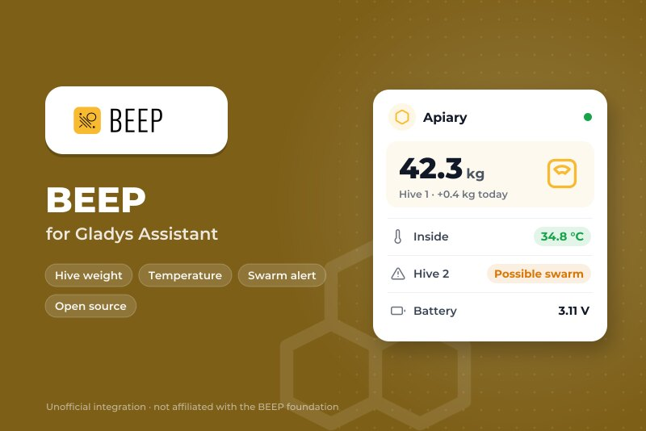
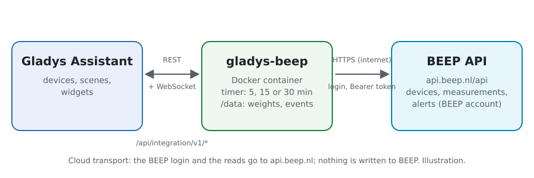
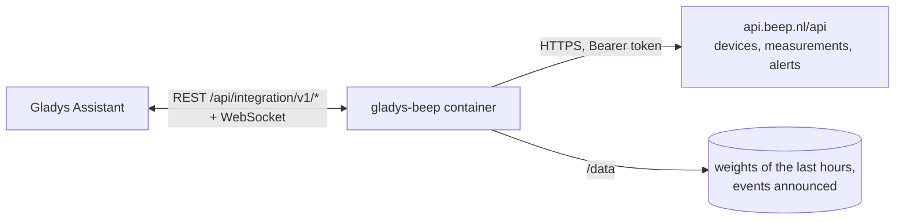
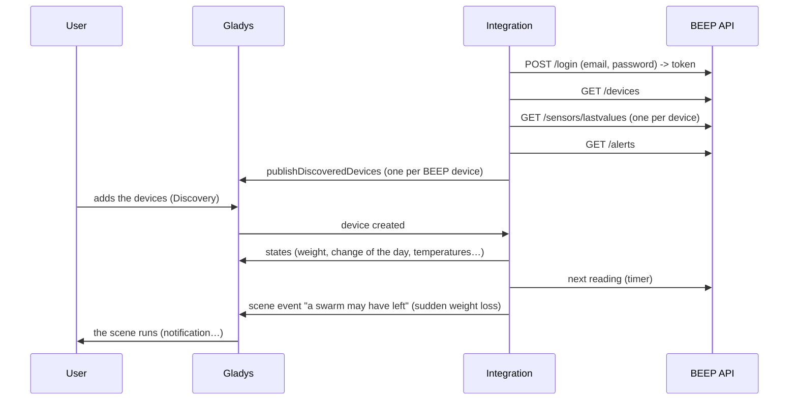
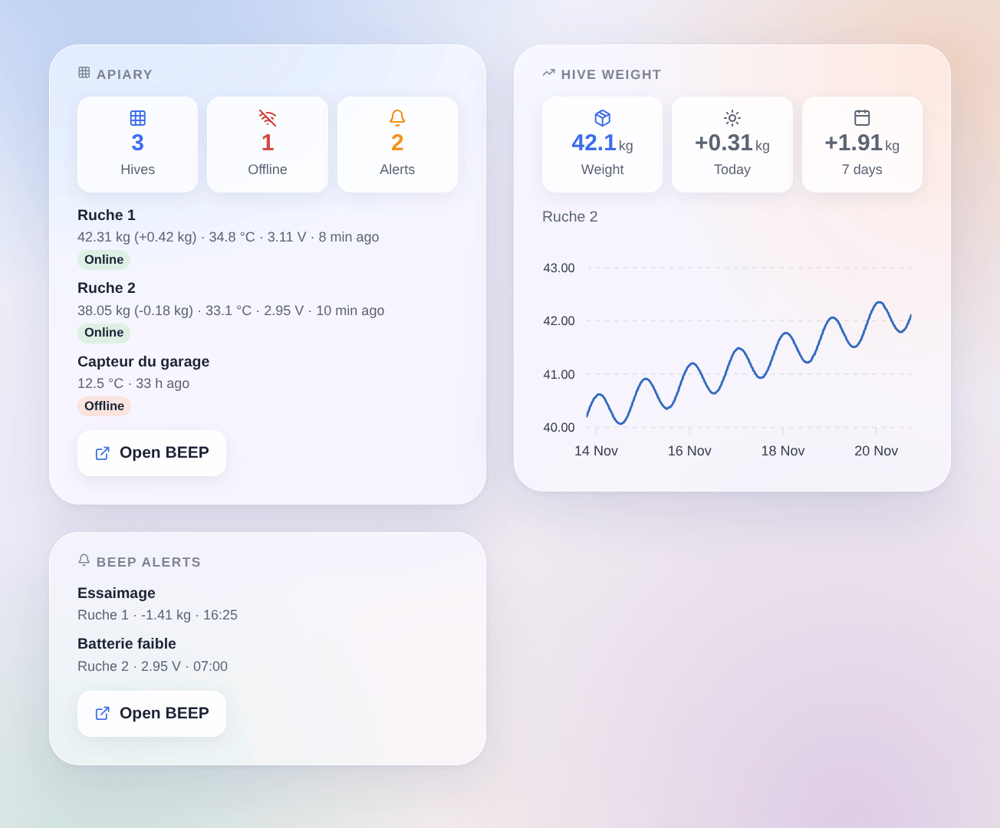

# Gladys BEEP

**English** · [Français](README.fr.md) · [Deutsch](README.de.md) · [Español](README.es.md)

[](LICENSE)
[](https://github.com/William-De71/gladys-beep/releases)
[](https://github.com/William-De71/gladys-beep/actions/workflows/release.yml)
[](https://gladysassistant.com)



[Gladys Assistant](https://gladysassistant.com) external integration for **[BEEP](https://beep.nl)**, the open source bee monitoring platform of the BEEP foundation: the weight, temperature and battery of your hives, scenes when a swarm may have left or a device stops sending, and dashboard widgets. It reads the API of your BEEP account (app.beep.nl).

## Features

- **One device per BEEP device** (a BEEP base under a hive, or any sensor posting to BEEP), named after its hive: weight, weight change of the day, temperature inside, temperature probes, outside temperature, humidity, air pressure, light, sound level, bee counts, battery voltage, as the device measures them.
- **3 scene triggers**, **1 scene action** and **3 dashboard widgets** (below).
- **Swarm detection**: a sudden weight loss (0.5 to 3 kg within an hour, configurable) fires a scene.
- Read on its own timer (every 5, 15 or 30 min): 2 requests, plus one per device. What the triggers announced and the weights of the last hours are kept in `/data`.
- Read only: the integration never changes anything in BEEP.
- Four languages everywhere: English, French, German, Spanish.

## How it works







### Transport

`transports: ["cloud"]`: everything goes to `api.beep.nl` over HTTPS. The integration logs in with the email and password of the configuration; the token BEEP returns stays in memory (never in `/data`) and travels in a header, never in the URL. A 401 logs in again once.

## Devices and features

| Device          | Feature                   | Category / type                | Unit |
| --------------- | ------------------------- | ------------------------------ | ---- |
| \<hive\> (BEEP) | Weight (kg)               | `counter-sensor` / decimal     |      |
|                 | Weight change today (kg)  | `counter-sensor` / decimal     |      |
|                 | Temperature inside        | `temperature-sensor` / decimal | °C   |
|                 | Humidity inside           | `humidity-sensor` / decimal    | %    |
|                 | Temperature               | `temperature-sensor` / decimal | °C   |
|                 | Humidity                  | `humidity-sensor` / decimal    | %    |
|                 | Air pressure              | `pressure-sensor` / decimal    | hPa  |
|                 | Light                     | `light-sensor` / decimal       | lux  |
|                 | Sound level               | `noise-sensor` / decimal       | dB   |
|                 | Bees in / Bees out        | `counter-sensor` / integer     |      |
|                 | Battery voltage           | `energy-sensor` / voltage      | V    |
|                 | Temperature probe 1 to 10 | `temperature-sensor` / decimal | °C   |

A device offers only the measurements it sent (BEEP abbreviations `weight_kg`, `t_i`, `h_i`, `t`, `h`, `p`, `l`, `s_spl`, `bc_i`, `bc_o`, `bv`, `t_0`…`t_9`), and keeps them once offered. Gladys has no kilogram unit yet: the weights are `counter-sensor` decimals whose name says "kg".

## Scene triggers, actions and widgets



- **Trigger "BEEP: a swarm may have left"**: the weight of a hive fell by the configured drop below its highest weight of the last hour; once per hive per 6 hours. Variables: `device`, `hive`, `device_name`, `weight_before`, `weight_after`, `drop_kg`, `measured_at`, `summary`.
- **Trigger "BEEP: a device stopped sending"**: BEEP marks a device offline (no measurement for twice its sending interval). Variables: `device`, `hive`, `device_name`, `last_message_at`, `summary`.
- **Trigger "BEEP: alert"**: an alert rule of the BEEP account fired (a new alert, or the same one raised again); at most 10 per reading. Variables: `rule`, `value`, `device`, `hive`, `device_name`, `location`, `count`, `alert_id`, `summary`.
- **Action "BEEP: summary of the apiary"**: outputs `summary` (one line per hive), `hives`, `offline`, `alerts`, `total_weight_kg`.
- **Widgets**: "Apiary" (tiles, each hive with weight, change of the day, temperature, battery, age of the last measurement, online or not), "Hive weight" (7 days read from BEEP, one curve per hive or the hive of the settings), "BEEP alerts" (the latest first).

The triggers filter on a hive (`device`). The first reading is a baseline: devices already offline and alerts already listed fire nothing. Examples:

- _A swarm may have left_ → send `{{triggerEvent.data.summary}}` by Telegram and turn on the garden light.
- _A device stopped sending_ → a notification "check the battery of {{triggerEvent.data.hive}}".
- _Every evening at 20:00_ → **summary of the apiary** → say `summary` on the speaker of the kitchen.

## Requirements

- Gladys Assistant **5.3.0** or later; older instances cannot install the integration.
- A BEEP account ([app.beep.nl](https://app.beep.nl)) with at least one device and a verified email.

## Installation

- **From the store**: Integrations → BEEP → Install.
- **From the repository URL**: Integrations → external integration → `https://github.com/William-De71/gladys-beep`.
- **Developer mode**: run `npm start` with the variables given by Gladys (see Development).

## Configuration

| Field                             | Default   | Meaning                                                                    |
| --------------------------------- | --------- | -------------------------------------------------------------------------- |
| Email                             | —         | Required: the email of the BEEP account                                    |
| Password                          | —         | Required, a secret: sent only to api.beep.nl, never shown again nor logged |
| Reading every                     | 15 min    | 5, 15 or 30 minutes                                                        |
| Swarm: weight loss within an hour | 1 kg      | 0.5, 1, 1.5, 2 or 3 kg                                                     |
| Language                          | Automatic | Device names and scene texts; automatic: the language of the last widget   |
| Read BEEP now                     | —         | Logs in, reads now and lists each hive                                     |

## Usage

1. Integrations → BEEP → Configuration: type the email and password of the BEEP account, press **Read BEEP now**.
2. Discovery: add your hives.
3. Add the widgets to a dashboard; create scenes with the triggers and the action.

## Development

```bash
npm install
npm test                       # node --test, a fake BEEP API, never the network
npm run lint                   # ESLint
npm run format:check           # Prettier
npx github:GladysAssistant/integration-store . --skip-image-check
scripts/build-cover.sh         # cover.jpg from docs/assets/cover.svg
docs/illustrations/render.sh   # docs/assets/widgets.<lang>.png
```

Locally, the SDK reads `GLADYS_HOST_API_URL`, `GLADYS_INTEGRATION_TOKEN` and `GLADYS_INTEGRATION_SELECTOR` (given by Gladys in developer mode), and the integration reads `TZ`. `DEBUG=gladys-integration-sdk` shows the SDK logs.

The tests cover the HTTP client (login, header token, a new login after a 401, errors, retry), the parsing of the BEEP answers, the events (swarm, offline, alerts, baseline, once only, restart), the devices (Gladys checks), the widgets (`validateWidgetContent`), the manifest, the four languages, the release script and the whole integration against the fake Gladys of the SDK. `test/structure.test.js` freezes the external ids and every key users store.

## Release process


Every merge on `main` runs the CI, then computes the version from the [Conventional Commits](https://www.conventionalcommits.org/) since the last tag: `feat` → minor, `fix` / `perf` → patch, `!` or `BREAKING CHANGE` → major (a minor below 1.0.0); `docs`, `chore`, `ci`, `test`, `style`, `refactor`, `build` alone publish nothing. The changelog section is generated, the tag pushed, the multi-architecture image built, then `main` receives the release commit, the GitHub Release is created and a last job checks the public image, the store validator and the topic.

- The pull request title becomes the squash commit, then the changelog line: write it in English, for the user (`pr-title.yml` checks it). Never edit `CHANGELOG.md` by hand.
- 1.0.0 is a decision: Actions → Release → Run workflow with `release-as: 1.0.0`. `dry-run` shows the version and the notes without publishing.
- **Protected branch**: the release pushes its commit to `main` with `GITHUB_TOKEN`. The `protect-main` ruleset (no deletion, no force-push) lets it through; a stricter rule (pull request required, status checks) would need GitHub Actions in its bypass list, or a GitHub App.

## Troubleshooting

See [docs/en.md](docs/en.md#troubleshooting). Report issues with the versions of Gladys and of the integration, your BEEP hardware and the message of **Read BEEP now**. Never paste your password.

## Contributing

Issues and pull requests are welcome. Run `npm run format:check && npm run lint && npm test` before opening a pull request, and keep every external id and stored key unchanged (see [CLAUDE.md](CLAUDE.md)).

## Security

See [SECURITY.md](SECURITY.md): report vulnerabilities privately. The password is a `secret` field: never logged, never written to `/data`, sent only to `api.beep.nl`; the token stays in memory.

## Screenshots to come

The images above are illustrations, not screenshots. Real screenshots will go in `docs/assets/screenshots/` (PNG, 1280 × 800): `configuration.png` (the configuration with its status), `discovery.png` (the hives offered), `device.png` (a hive device with its weight), `scene-swarm.png` (a scene on the swarm trigger).

## License

[Apache License 2.0](LICENSE) — see also [NOTICE](NOTICE). Hives, measurements and alerts: your BEEP account, through the [BEEP API](https://github.com/beepnl/BEEP). This project is not affiliated with, endorsed or sponsored by the BEEP foundation. Thanks to the Gladys documentation and SDK, and to the BEEP foundation for an open source platform.
