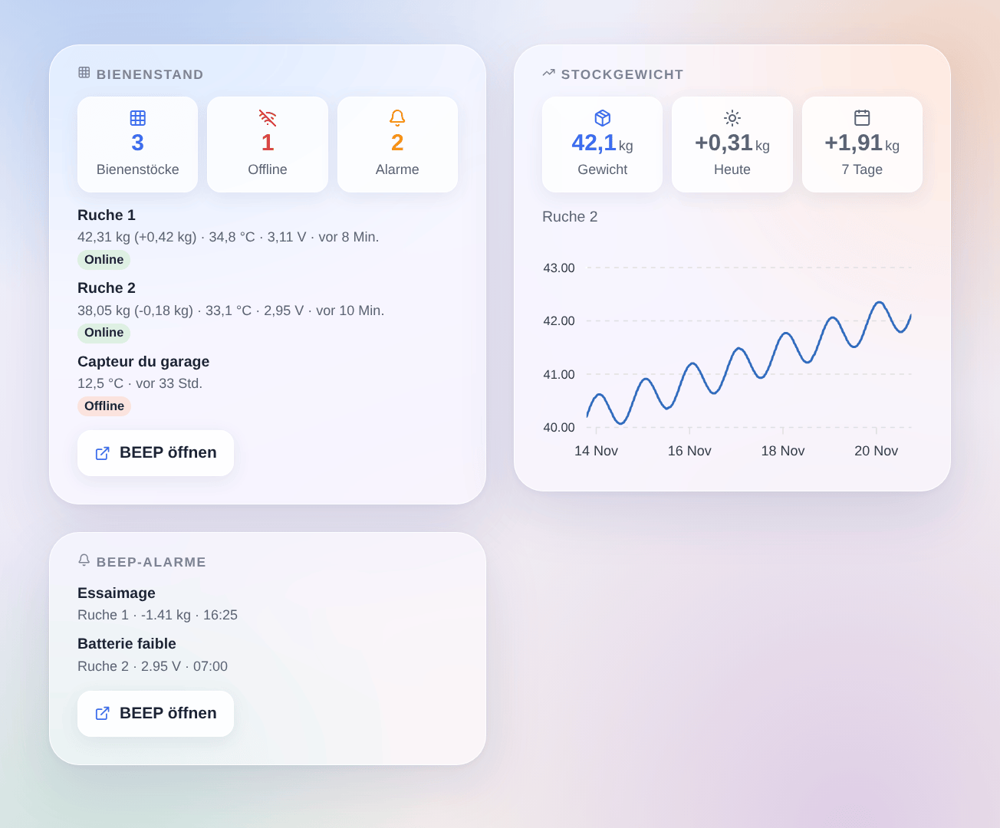

# BEEP

## Überblick

Diese Integration bringt **BEEP** in Gladys. BEEP ist die Open-Source-Plattform der BEEP-Stiftung zur Überwachung von Bienenstöcken ([app.beep.nl](https://app.beep.nl)): Die **BEEP base** steht unter einem Bienenstock, wiegt ihn und misst seine Temperatur; auch andere Sensoren können Messwerte an BEEP senden. Die Integration liest dein BEEP-Konto: deine Geräte, ihre letzten Messwerte und die Alarme deiner Alarmregeln.

Sie bietet ein Gerät pro BEEP-Gerät auf dem Erkennungsbildschirm, drei Szenenauslöser (vielleicht ist ein Schwarm abgegangen, ein Gerät sendet nicht mehr, ein BEEP-Alarm), eine Szenenaktion (eine Zusammenfassung des Bienenstands) und drei Dashboard-Widgets. Sie ändert nie etwas in BEEP.

## Voraussetzungen

- Gladys Assistant 5.3.0 oder neuer.
- Ein BEEP-Konto mit mindestens einem Gerät (einer BEEP base oder einem in der BEEP-App hinzugefügten Sensor) und bestätigter E-Mail-Adresse.
- Die E-Mail-Adresse und das Passwort dieses Kontos: BEEP gewährt API-Zugriff nur nach einer Anmeldung.

### Bevor du beginnst

1. Melde dich auf [app.beep.nl](https://app.beep.nl) an und prüfe, ob deine Geräte Messwerte senden (Menü Geräte).
2. Um von BEEP selbst gewarnt zu werden (schwache Batterie, Temperatur, Gewicht), lege Alarmregeln in der BEEP-App an (Menü Alarme): Die Integration macht daraus einen Szenenauslöser.
3. Wenn du Bienenstöcke in einer BEEP-Gruppe teilst, kommen auch deren Geräte.

## Konfiguration

| Feld                                     | Standard    | Bedeutung                                                                                  |
| ---------------------------------------- | ----------- | ------------------------------------------------------------------------------------------ |
| E-Mail-Adresse                           | —           | Pflichtfeld. Die E-Mail-Adresse des BEEP-Kontos                                            |
| Passwort                                 | —           | Pflichtfeld. Wird nur an api.beep.nl gesendet, nie wieder angezeigt oder protokolliert     |
| Abfrage alle                             | 15 Min.     | 5, 15 oder 30 Minuten; jede Abfrage stellt 2 Anfragen an BEEP, plus eine pro Gerät         |
| Schwarm: Gewichtsverlust in einer Stunde | 1 kg        | 0,5 bis 3 kg: Wähle mehr, als eine Durchsicht des Stocks entfernt                          |
| Sprache                                  | Automatisch | Gerätenamen und Szenentexte; automatisch folgt der Sprache des zuletzt angezeigten Widgets |
| BEEP jetzt abfragen                      | —           | Meldet sich an, fragt jetzt ab und listet jeden Bienenstock                                |

## Verwendung

### Geräte

Auf dem Erkennungsbildschirm ein Gerät pro BEEP-Gerät, benannt nach seinem Bienenstock („Ruche 1 (BEEP)“) oder nach dem Gerät, wenn es keinem Stock zugeordnet ist. Es bietet eine Funktion für jeden Messwert, den das Gerät tatsächlich sendet:

- Gewicht (kg) und **Gewichtsänderung heute** (kg seit dem ersten Gewicht des Tages, Ortszeit);
- Innentemperatur des Stocks, Temperaturfühler zwischen den Waben, Außentemperatur;
- Luftfeuchtigkeit (innen und außen), Luftdruck, Helligkeit, Schallpegel;
- ein- und ausfliegende Bienen (Bienenzähler), Batteriespannung.

Gladys hat noch keine Einheit Kilogramm: Die Gewichte sind Zahlen, deren Name „kg“ angibt.

### Dashboard-Widgets

- **Bienenstand**: Anzahl der Bienenstöcke, der Geräte offline und der Alarme, dann jeder Stock mit Gewicht, Tagesänderung, Temperatur, Batterie und letztem Messwert.
- **Stockgewicht**: das Gewicht der letzten 7 Tage, aus BEEP gelesen (eine Kurve pro Stock, höchstens 4, oder der in den Einstellungen gewählte Stock), mit dem aktuellen Gewicht und seiner Änderung über den Tag und die Woche.
- **BEEP-Alarme**: die Alarme deiner Alarmregeln, die neuesten zuerst.

### Szenen

- **Auslöser „BEEP: Vielleicht ist ein Schwarm abgegangen“**: Das Gewicht eines Stocks ist um den eingestellten Wert unter sein höchstes Gewicht der letzten Stunde gefallen; einmal pro Stock alle 6 Stunden. Variablen: Bienenstock, Gewicht vorher und nachher, Verlust, Uhrzeit, Zusammenfassung.
- **Auslöser „BEEP: Ein Gerät sendet nicht mehr“**: BEEP empfängt die Messwerte eines Geräts nicht mehr (nach dem Doppelten seines Sendeintervalls). Variablen: Bienenstock, letzte Meldung, Zusammenfassung.
- **Auslöser „BEEP: Alarm“**: Eine Alarmregel deines BEEP-Kontos hat ausgelöst (ein neuer Alarm oder derselbe erneut). Variablen: Regel, Wert, Bienenstock, Bienenstand, Anzahl der Auslösungen, Zusammenfassung.
- **Aktion „BEEP: Zusammenfassung des Bienenstands“**: eine Zeile pro Stock, die Anzahl der Stöcke, der Geräte offline, der Alarme und das Gesamtgewicht, für eine Nachricht oder eine Sprachantwort.

Die drei Auslöser lassen sich auf einen Bienenstock filtern. Die erste Abfrage dient als Referenz: Bereits offline gemeldete Geräte und bereits gelistete Alarme lösen nichts aus, und ein Neustart löst nie zweimal aus.

Beispiele: Wenn vielleicht ein Schwarm abgegangen ist, die Zusammenfassung per Telegram senden und das Gartenlicht einschalten; wenn ein Gerät nicht mehr sendet, eine Benachrichtigung senden; jeden Abend die Zusammenfassung des Bienenstands in der Küche ansagen.

### Übertragung

Nur Cloud: Die Integration spricht per HTTPS mit api.beep.nl. Das Passwort dient der Anmeldung; das von BEEP zurückgegebene Token bleibt im Speicher und wird in einem Header übertragen, nie in einer Webadresse.

## Fehlerbehebung

- **„BEEP hat die E-Mail-Adresse oder das Passwort abgelehnt“**: Melde dich damit auf app.beep.nl an und speichere dann die Konfiguration erneut.
- **„Die E-Mail-Adresse dieses BEEP-Kontos ist noch nicht bestätigt“**: Öffne den Link, den BEEP bei der Registrierung geschickt hat.
- **Kein Gewicht**: Das Gerät wiegt nicht oder hat seit einem Jahr keinen Messwert gesendet; prüfe es in der BEEP-App.
- **Ein Schwarmalarm während einer Durchsicht**: Auch das Öffnen des Stocks und das Herausnehmen von Waben senken das Gewicht; erhöhe den Schwellenwert.
- **„BEEP begrenzt die Anzahl der Anfragen“**: BEEP erlaubt 60 Anfragen pro Minute; bei vielen Geräten alle 15 oder 30 Minuten abfragen.
- Protokolle: Einstellungen → Überwachung, die Protokolle der Integration. Sie enthalten nie dein Passwort oder dein Token.
