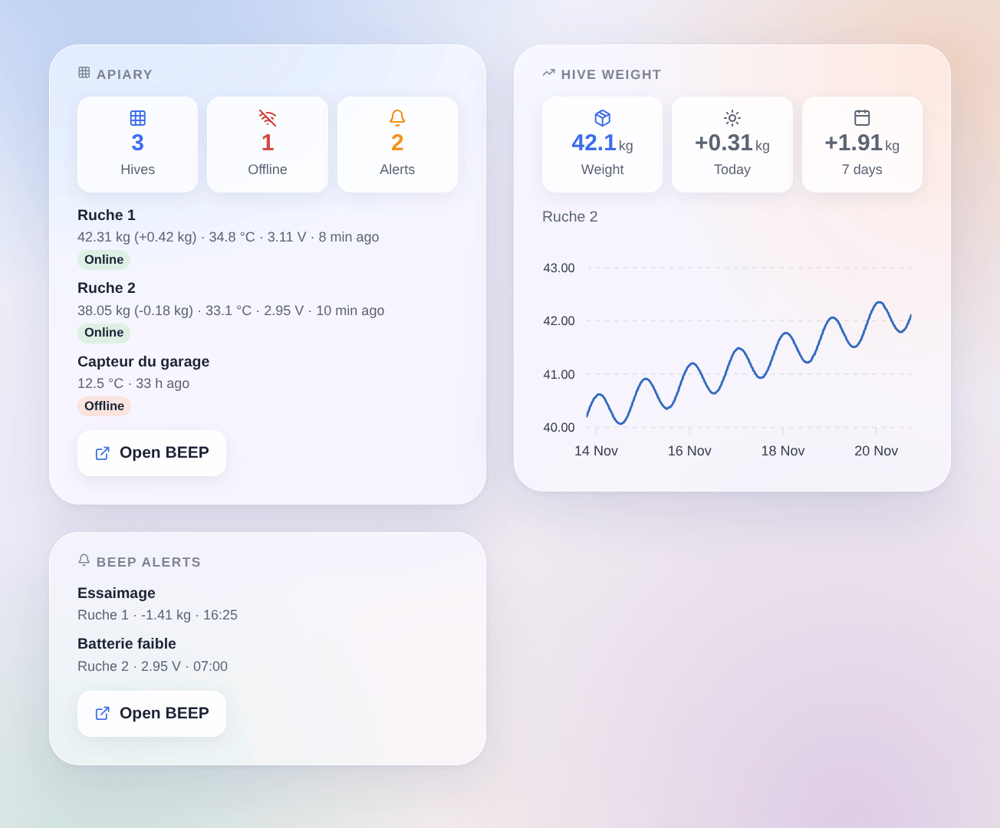

# BEEP

## Overview

This integration brings **BEEP** into Gladys. BEEP is the open source bee monitoring platform of the BEEP foundation ([app.beep.nl](https://app.beep.nl)): the **BEEP base** sits under a hive, weighs it and measures its temperature, and other sensors can post to BEEP too. The integration reads your BEEP account: your devices, their last measurements and the alerts of your alert rules.

It offers one device per BEEP device on the Discovery screen, three scene triggers (a swarm may have left, a device stopped sending, a BEEP alert), a scene action (a summary of the apiary) and three dashboard widgets. It never changes anything in BEEP.

## Prerequisites

- Gladys Assistant 5.3.0 or later.
- A BEEP account with at least one device (a BEEP base, or a sensor added in the BEEP app), and its email verified.
- The email and password of that account: BEEP gives API access only after a login.

### Before you start

1. Sign in on [app.beep.nl](https://app.beep.nl) and check that your devices send measurements (Devices menu).
2. To be alerted by BEEP itself (low battery, temperature, weight), create alert rules in the BEEP app (Alerts menu): the integration turns them into a scene trigger.
3. If you share hives through a BEEP group, their devices come too.

## Configuration

| Field                             | Default   | Meaning                                                                               |
| --------------------------------- | --------- | ------------------------------------------------------------------------------------- |
| Email                             | —         | Required. The email of the BEEP account                                               |
| Password                          | —         | Required. Sent only to api.beep.nl, never shown again, never logged                   |
| Reading every                     | 15 min    | 5, 15 or 30 minutes; each reading asks BEEP 2 times plus once per device              |
| Swarm: weight loss within an hour | 1 kg      | 0.5 to 3 kg: choose more than what a visit of the hive removes                        |
| Language                          | Automatic | Device names and scene texts; automatic follows the language of the last widget shown |
| Read BEEP now                     | —         | Logs in, reads now and lists each hive                                                |

## Usage

### Devices

On the Discovery screen, one device per BEEP device, named after its hive ("Hive 1 (BEEP)") or after the device when it has no hive. It offers a feature for each measurement the device actually sends:

- weight (kg) and **weight change today** (kg since the first weight of the day, local time);
- temperature inside the hive, temperature probes between the frames, outside temperature;
- humidity (inside and outside), air pressure, light, sound level;
- bees in and out (bee counters), battery voltage.

Gladys has no kilogram unit yet: the weights are numbers whose name says "kg".

### Dashboard widgets

- **Apiary**: number of hives, offline devices and alerts, then each hive with its weight, change of the day, temperature, battery and last measurement.
- **Hive weight**: the weight of the last 7 days, read from BEEP (one curve per hive, 4 at most, or the hive chosen in the settings), with the weight now and its change over the day and the week.
- **BEEP alerts**: the alerts of your alert rules, the latest first.

### Scenes

- **Trigger "BEEP: a swarm may have left"**: the weight of a hive fell by the configured value below its highest weight of the last hour; once per hive per 6 hours. Variables: hive, weight before and after, loss, time, summary.
- **Trigger "BEEP: a device stopped sending"**: BEEP no longer receives the measurements of a device (after twice its sending interval). Variables: hive, last message, summary.
- **Trigger "BEEP: alert"**: an alert rule of your BEEP account fired (a new alert, or the same one raised again). Variables: rule, value, hive, apiary, times raised, summary.
- **Action "BEEP: summary of the apiary"**: one line per hive, the number of hives, offline devices, alerts and the total weight, for a message or a spoken answer.

The three triggers can be filtered on one hive. The first reading is a baseline: devices already offline and alerts already listed fire nothing, and a restart never fires twice.

Examples: when a swarm may have left, send the summary by Telegram and turn on the garden light; when a device stops sending, send a notification; every evening, say the summary of the apiary in the kitchen.

### Transport

Cloud only: the integration talks to api.beep.nl over HTTPS. The password is used to log in; the token BEEP returns stays in memory and travels in a header, never in a web address.

## Troubleshooting

- **"BEEP refused the email or the password"**: sign in on app.beep.nl with them, then save the configuration again.
- **"The email of this BEEP account is not verified"**: open the link BEEP sent at sign-up.
- **No weight**: the device does not weigh, or has not sent a measurement for a year; check it in the BEEP app.
- **A swarm alert during a visit**: opening the hive and taking frames out also makes the weight fall; raise the threshold.
- **"BEEP limits the number of requests"**: BEEP allows 60 requests per minute; with many devices, read every 15 or 30 minutes.
- Logs: Settings → Supervision, the logs of the integration. They never contain your password nor your token.
