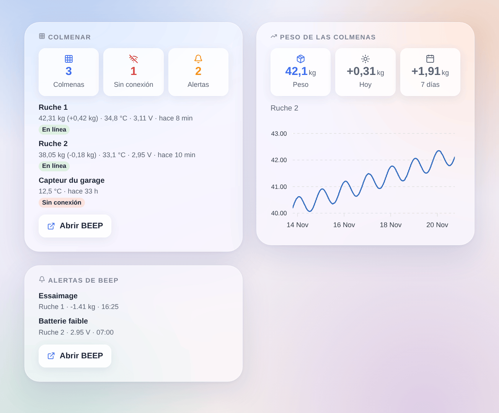

# BEEP

## Presentación

Esta integración lleva **BEEP** a Gladys. BEEP es la plataforma de código abierto de la fundación BEEP para el seguimiento de colmenas ([app.beep.nl](https://app.beep.nl)): la **BEEP base** se coloca bajo una colmena, la pesa y mide su temperatura, y otros sensores también pueden enviar sus mediciones a BEEP. La integración lee su cuenta BEEP: sus dispositivos, sus últimas mediciones y las alertas de sus reglas de alerta.

Ofrece un dispositivo por cada dispositivo BEEP en la pantalla de descubrimiento, tres disparadores de escena (puede que haya salido un enjambre, un dispositivo dejó de enviar, una alerta de BEEP), una acción de escena (un resumen del colmenar) y tres widgets de panel. Nunca modifica nada en BEEP.

## Requisitos previos

- Gladys Assistant 5.3.0 o posterior.
- Una cuenta BEEP con al menos un dispositivo (una BEEP base, o un sensor añadido en la aplicación BEEP), con el correo electrónico verificado.
- El correo electrónico y la contraseña de esa cuenta: BEEP solo da acceso a su API tras iniciar sesión.

### Antes de empezar

1. Inicie sesión en [app.beep.nl](https://app.beep.nl) y compruebe que sus dispositivos envían mediciones (menú Dispositivos).
2. Para recibir avisos del propio BEEP (batería baja, temperatura, peso), cree reglas de alerta en la aplicación BEEP (menú Alertas): la integración las convierte en un disparador de escena.
3. Si comparte colmenas en un grupo de BEEP, sus dispositivos también aparecen.

## Configuración

| Campo                                    | Por defecto | Significado                                                                                                |
| ---------------------------------------- | ----------- | ---------------------------------------------------------------------------------------------------------- |
| Correo electrónico                       | —           | Obligatorio. El correo electrónico de la cuenta BEEP                                                       |
| Contraseña                               | —           | Obligatoria. Solo se envía a api.beep.nl, nunca se vuelve a mostrar ni se registra                         |
| Lectura cada                             | 15 min      | 5, 15 o 30 minutos; cada lectura consulta BEEP 2 veces, más una por dispositivo                            |
| Enjambrazón: pérdida de peso en una hora | 1 kg        | De 0,5 a 3 kg: elija más de lo que retira una revisión de la colmena                                       |
| Idioma                                   | Automático  | Nombres de los dispositivos y textos de las escenas; automático sigue el idioma del último widget mostrado |
| Leer BEEP ahora                          | —           | Inicia sesión, lee ahora y enumera cada colmena                                                            |

## Uso

### Dispositivos

En la pantalla de descubrimiento, un dispositivo por cada dispositivo BEEP, con el nombre de su colmena («Ruche 1 (BEEP)») o del dispositivo si no tiene colmena. Ofrece una función por cada medición que el dispositivo envía realmente:

- peso (kg) y **variación de peso de hoy** (kg desde el primer peso del día, hora local);
- temperatura interior de la colmena, sondas de temperatura entre los cuadros, temperatura exterior;
- humedad (interior y exterior), presión atmosférica, luminosidad, nivel sonoro;
- abejas que entran y salen (contadores de abejas), tensión de la batería.

Gladys todavía no tiene unidad de kilogramo: los pesos son números cuyo nombre indica «kg».

### Widgets del panel

- **Colmenar**: número de colmenas, de dispositivos sin conexión y de alertas, y luego cada colmena con su peso, variación del día, temperatura, batería y última medición.
- **Peso de las colmenas**: el peso de los últimos 7 días, leído en BEEP (una curva por colmena, 4 como máximo, o la colmena elegida en los ajustes), con el peso actual y su variación en el día y en la semana.
- **Alertas de BEEP**: las alertas de sus reglas de alerta, las más recientes primero.

### Escenas

- **Disparador «BEEP: puede que haya salido un enjambre»**: el peso de una colmena cayó el valor configurado por debajo de su peso más alto de la última hora; una vez por colmena cada 6 horas. Variables: colmena, peso antes y después, pérdida, hora, resumen.
- **Disparador «BEEP: un dispositivo dejó de enviar»**: BEEP ya no recibe las mediciones de un dispositivo (tras el doble de su intervalo de envío). Variables: colmena, último mensaje, resumen.
- **Disparador «BEEP: alerta»**: se activó una regla de alerta de su cuenta BEEP (una alerta nueva, o la misma de nuevo). Variables: regla, valor, colmena, colmenar, veces generada, resumen.
- **Acción «BEEP: resumen del colmenar»**: una línea por colmena, el número de colmenas, de dispositivos sin conexión, de alertas y el peso total, para un mensaje o una respuesta de voz.

Los tres disparadores pueden filtrarse por colmena. La primera lectura sirve de referencia: los dispositivos ya sin conexión y las alertas ya listadas no disparan nada, y un reinicio nunca dispara dos veces.

Ejemplos: cuando puede que haya salido un enjambre, enviar el resumen por Telegram y encender la luz del jardín; cuando un dispositivo deja de enviar, enviar una notificación; cada noche, anunciar el resumen del colmenar en la cocina.

### Transporte

Solo nube: la integración se comunica con api.beep.nl por HTTPS. La contraseña sirve para iniciar sesión; el token que devuelve BEEP se queda en memoria y viaja en una cabecera, nunca en una dirección web.

## Solución de problemas

- **«BEEP rechazó el correo electrónico o la contraseña»**: inicie sesión con ellos en app.beep.nl y vuelva a guardar la configuración.
- **«El correo electrónico de esta cuenta BEEP aún no está verificado»**: abra el enlace que BEEP envió al registrarse.
- **Sin peso**: el dispositivo no pesa, o no ha enviado ninguna medición desde hace un año; compruébelo en la aplicación BEEP.
- **Una alerta de enjambrazón durante una revisión**: abrir la colmena y sacar cuadros también hace bajar el peso; suba el umbral.
- **«BEEP limita el número de solicitudes»**: BEEP permite 60 solicitudes por minuto; con muchos dispositivos, lea cada 15 o 30 minutos.
- Registros: Ajustes → Supervisión, los registros de la integración. Nunca contienen su contraseña ni su token.
