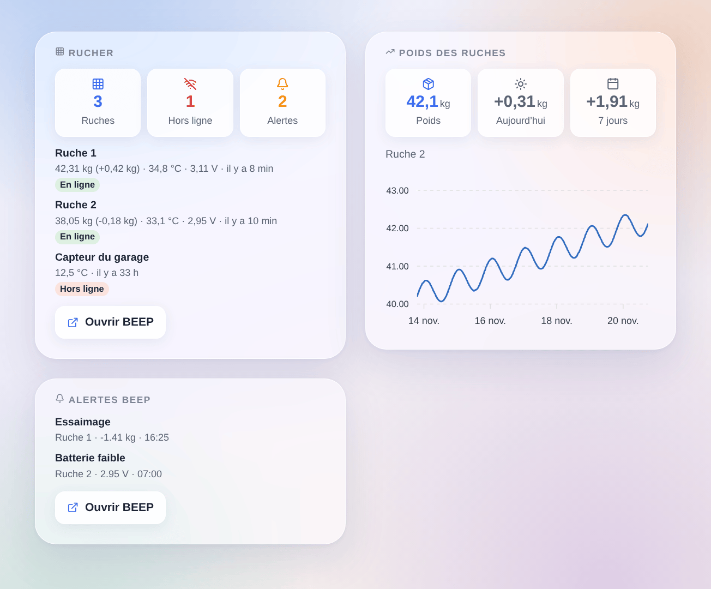

# BEEP

## Présentation

Cette intégration apporte **BEEP** dans Gladys. BEEP est la plateforme open source de suivi des ruches de la fondation BEEP ([app.beep.nl](https://app.beep.nl)) : la **BEEP base** se place sous une ruche, la pèse et mesure sa température, et d’autres capteurs peuvent aussi envoyer leurs mesures à BEEP. L’intégration lit votre compte BEEP : vos appareils, leurs dernières mesures et les alertes de vos règles d’alerte.

Elle propose un appareil par appareil BEEP dans l’écran de découverte, trois déclencheurs de scène (un essaim est peut-être parti, un appareil n’envoie plus rien, une alerte BEEP), une action de scène (un résumé du rucher) et trois widgets de tableau de bord. Elle ne modifie jamais rien dans BEEP.

## Prérequis

- Gladys Assistant 5.3.0 ou plus récent.
- Un compte BEEP avec au moins un appareil (une BEEP base, ou un capteur ajouté dans l’application BEEP), et son e-mail vérifié.
- L’e-mail et le mot de passe de ce compte : BEEP ne donne accès à son API qu’après une connexion.

### Avant de commencer

1. Connectez-vous sur [app.beep.nl](https://app.beep.nl) et vérifiez que vos appareils envoient des mesures (menu Appareils).
2. Pour être alerté par BEEP lui-même (batterie faible, température, poids), créez des règles d’alerte dans l’application BEEP (menu Alertes) : l’intégration en fait un déclencheur de scène.
3. Si vous partagez des ruches dans un groupe BEEP, leurs appareils arrivent aussi.

## Configuration

| Champ                                   | Défaut      | Signification                                                                                  |
| --------------------------------------- | ----------- | ---------------------------------------------------------------------------------------------- |
| E-mail                                  | —           | Obligatoire. L’e-mail du compte BEEP                                                           |
| Mot de passe                            | —           | Obligatoire. Envoyé seulement à api.beep.nl, jamais réaffiché ni journalisé                    |
| Lecture toutes les                      | 15 min      | 5, 15 ou 30 minutes ; chaque lecture interroge BEEP 2 fois, plus une fois par appareil         |
| Essaimage : perte de poids en une heure | 1 kg        | De 0,5 à 3 kg : choisissez plus que ce qu’une visite de la ruche retire                        |
| Langue                                  | Automatique | Noms des appareils et textes des scènes ; automatique suit la langue du dernier widget affiché |
| Lire BEEP maintenant                    | —           | Se connecte, lit maintenant et liste chaque ruche                                              |

## Utilisation

### Appareils

Dans l’écran de découverte, un appareil par appareil BEEP, au nom de sa ruche (« Ruche 1 (BEEP) ») ou de l’appareil s’il n’a pas de ruche. Il propose une fonctionnalité pour chaque mesure que l’appareil envoie réellement :

- poids (kg) et **variation de poids du jour** (kg depuis le premier poids de la journée, heure locale) ;
- température intérieure de la ruche, sondes de température entre les cadres, température extérieure ;
- humidité (intérieure et extérieure), pression atmosphérique, luminosité, niveau sonore ;
- abeilles entrées et sorties (compteurs d’abeilles), tension de la batterie.

Gladys n’a pas encore d’unité kilogramme : les poids sont des nombres dont le nom indique « kg ».

### Widgets de tableau de bord

- **Rucher** : nombre de ruches, d’appareils hors ligne et d’alertes, puis chaque ruche avec son poids, sa variation du jour, sa température, sa batterie et sa dernière mesure.
- **Poids des ruches** : le poids des 7 derniers jours, lu dans BEEP (une courbe par ruche, 4 au plus, ou la ruche choisie dans les réglages), avec le poids actuel et sa variation sur la journée et la semaine.
- **Alertes BEEP** : les alertes de vos règles d’alerte, les plus récentes d’abord.

### Scènes

- **Déclencheur « BEEP : un essaim est peut-être parti »** : le poids d’une ruche est tombé de la valeur configurée sous son poids le plus haut de la dernière heure ; une fois par ruche toutes les 6 heures. Variables : ruche, poids avant et après, perte, heure, résumé.
- **Déclencheur « BEEP : un appareil n’envoie plus rien »** : BEEP ne reçoit plus les mesures d’un appareil (après deux fois son intervalle d’envoi). Variables : ruche, dernier message, résumé.
- **Déclencheur « BEEP : alerte »** : une règle d’alerte de votre compte BEEP s’est déclenchée (nouvelle alerte, ou la même levée de nouveau). Variables : règle, valeur, ruche, rucher, nombre de déclenchements, résumé.
- **Action « BEEP : résumé du rucher »** : une ligne par ruche, le nombre de ruches, d’appareils hors ligne, d’alertes et le poids total, pour un message ou une réponse vocale.

Les trois déclencheurs peuvent être filtrés sur une ruche. La première lecture sert de référence : les appareils déjà hors ligne et les alertes déjà listées ne déclenchent rien, et un redémarrage ne déclenche jamais deux fois.

Exemples : quand un essaim est peut-être parti, envoyer le résumé par Telegram et allumer la lumière du jardin ; quand un appareil n’envoie plus rien, envoyer une notification ; chaque soir, annoncer le résumé du rucher dans la cuisine.

### Transport

Cloud uniquement : l’intégration dialogue avec api.beep.nl en HTTPS. Le mot de passe sert à se connecter ; le jeton renvoyé par BEEP reste en mémoire et voyage dans un en-tête, jamais dans une adresse web.

## Dépannage

- **« BEEP a refusé l’e-mail ou le mot de passe »** : connectez-vous avec sur app.beep.nl, puis enregistrez de nouveau la configuration.
- **« L’e-mail de ce compte BEEP n’est pas encore vérifié »** : ouvrez le lien envoyé par BEEP à l’inscription.
- **Pas de poids** : l’appareil ne pèse pas, ou n’a envoyé aucune mesure depuis un an ; vérifiez-le dans l’application BEEP.
- **Une alerte d’essaimage pendant une visite** : ouvrir la ruche et sortir des cadres fait aussi baisser le poids ; augmentez le seuil.
- **« BEEP limite le nombre de requêtes »** : BEEP autorise 60 requêtes par minute ; avec beaucoup d’appareils, lisez toutes les 15 ou 30 minutes.
- Journaux : Paramètres → Supervision, les journaux de l’intégration. Ils ne contiennent jamais votre mot de passe ni votre jeton.
